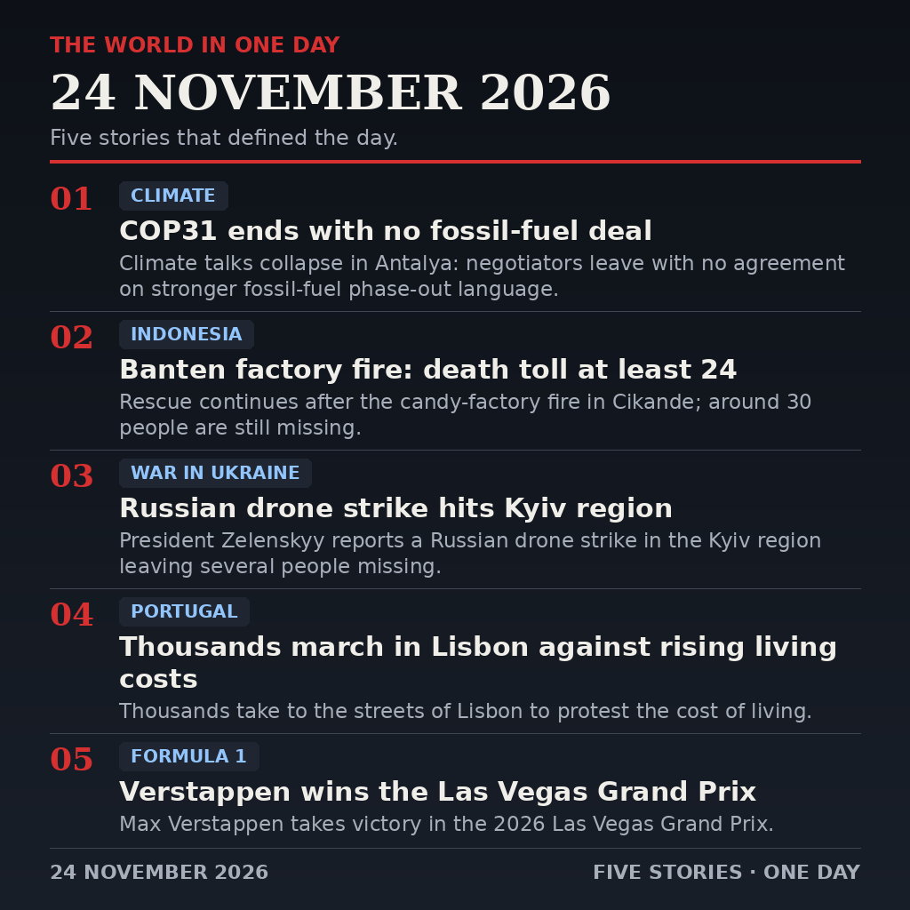

# 24 November 2026 in One Image

[](https://make.fun/bounty/news-image-20261124)
[](https://make.fun/bounty/news-image-20261124)
[](https://make.fun/bounty/news-image-20261124)

A deterministic program that renders **one 1024×1024 PNG** summing up
24 November 2026's world news — five verified stories, one image.

## The five stories

1. **COP31 ends with no fossil-fuel deal** — climate talks collapse in
   Antalya, Türkiye, with no agreement on stronger fossil-fuel
   phase-out language. (NDTV)
2. **Banten factory fire: death toll at least 24** — rescue continues
   after the candy-factory fire in Cikande, Indonesia; around 30 people
   are still missing.
3. **Russian drone strike hits Kyiv region** — President Zelenskyy reports
   a Russian drone strike in the Kyiv region leaving several people
   missing. (The Guardian)
4. **Thousands march in Lisbon against rising living costs** — thousands
   take to the streets of Lisbon to protest the cost of living.
5. **Verstappen wins the Las Vegas Grand Prix** — Max Verstappen takes
   victory in the 2026 Las Vegas Grand Prix.

## Run it

```bash
python3 main.py
```

Requires Python 3.12 and Pillow 10.2.0 (stdlib + PIL only).
Writes `/output/entry.png` (and a local copy `entry.png`).

The render is fully deterministic: fixed layout, fixed fonts, no
timestamps, no randomness — the same bytes on every run.

## Output



## License

MIT — see [LICENSE](LICENSE).
